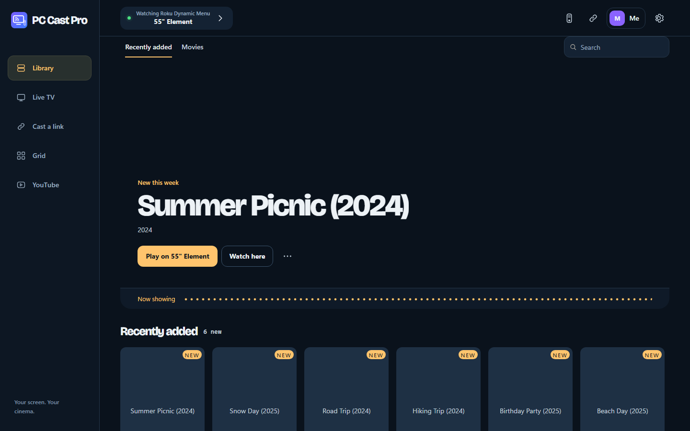
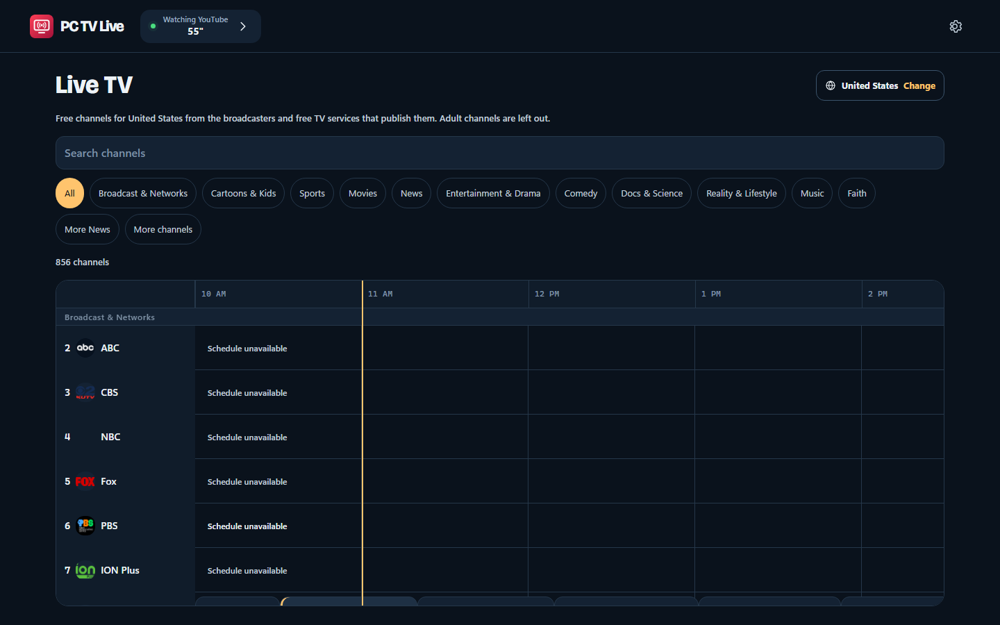

# IN3RT1A apps for Windows and Linux

Free apps that get your PC and your TVs working together.

## Download

| App | What it does | Windows | Linux |
|---|---|---|---|
| **PC Cast Pro** | The whole package: TV remote, casting from any link, multicast to many TVs, your PC's video library, multi-screen grids and free live TV | [Setup.exe](https://github.com/clark719664/pc-tv-apps/releases/latest/download/PC-Cast-Pro-Setup.exe) | [tar.gz](https://github.com/clark719664/pc-tv-apps/releases/latest/download/PC-Cast-Pro-Linux-x86_64.tar.gz) |
| **PC Cast Lite** | Just the casting. Paste a link and it plays on one TV or several | [Setup.exe](https://github.com/clark719664/pc-tv-apps/releases/latest/download/PC-Cast-Lite-Setup.exe) | [tar.gz](https://github.com/clark719664/pc-tv-apps/releases/latest/download/PC-Cast-Lite-Linux-x86_64.tar.gz) |
| **PC TV Live** | Just free live TV: pick your country, get its channels and a guide | [Setup.exe](https://github.com/clark719664/pc-tv-apps/releases/latest/download/PC-TV-Live-Setup.exe) | [tar.gz](https://github.com/clark719664/pc-tv-apps/releases/latest/download/PC-TV-Live-Linux-x86_64.tar.gz) |
| **PC TV Remote** | Just the remote, in a small download | [Setup.exe](https://github.com/clark719664/pc-tv-apps/releases/latest/download/PC-TV-Remote-Setup.exe) | [tar.gz](https://github.com/clark719664/pc-tv-apps/releases/latest/download/PC-TV-Remote-Linux-x86_64.tar.gz) |

**Windows:** run the Setup file and click **Install**. Everything each app needs on the PC is included, and no administrator rights are needed. Setup offers to add a firewall rule so your TVs can reach the app; Windows asks for permission once.

**Linux (x86_64, Ubuntu 22.04 / Debian 12 or newer):** extract the tar.gz and run `./install.sh`. Add `--service` to run it in the background from boot, for a small always-on box.

Portable ZIPs, SHA-256 checksums and third-party source code are on [the latest release](https://github.com/clark719664/pc-tv-apps/releases/latest).

## Screenshots

**PC Cast Pro** (your video library, with profiles)

**PC TV Live** (the guide for the United States)

**PC TV Remote**

**PC Cast Lite** (first-run welcome)

## What's new in 2026.10.21.3

- **Cast a link plays the best version**: PC Cast Pro and Lite pick the highest resolution a page offers, up to 4K, and show what you're getting, for example `1080p60 · 6.2 Mb/s · H.264`.
- **More pages work**: broadcasters' live pages and news sites with an embedded YouTube, Vimeo, Dailymotion or Twitch player, PeerTube video sites, and direct links to video files and HLS or DASH streams.
- **Clear reasons** when a link can't play: it needs a sign-in, isn't available in your region, isn't live right now, or is gone.
- **PC TV Live guide** (since 2026.10.21.2): schedules for ABC, CBS, NBC, Fox, PBS and ION Plus, and a full day of Pluto TV and Plex listings.

Earlier this month: PC TV Live, multicast to many TVs, embedded players, Linux versions of all four apps, and donor messages. See [all releases](https://github.com/clark719664/pc-tv-apps/releases).

## Setup

Keep the PC on and awake, on the same network as the TV. TVs are found automatically, and the apps walk you through any TV pairing and the one-time Roku PC Cast channel setup.

Tested by the developer on TVs on their own network. Other TV models can vary; additional TV brands and casting protocols remain beta.

The apps aren't code-signed yet, so Windows SmartScreen may warn you. Click **More info**, then **Run anyway**.

GitHub's automatically generated "Source code" archives are not the apps.

## Keep it free

All four apps are free, with no ads, no accounts and no trial. They stay that way because people who use them chip in when they can.

**[Donate on Payhip](https://payhip.com/b/Wn9fE)**: pay what you want, from $1. Payhip handles the checkout, and you get a thank-you PDF.

At checkout there's an optional box for a short message. Once it's approved, your first name and message scroll across the top of every app's home screen, for everyone who uses them. Messages are checked by hand before they appear, and you can leave the box empty.

Other ways to help, free:

- Share [payhip.com/IN3RT1A](https://payhip.com/IN3RT1A) or this page with someone who has a smart TV.
- Star this repository so more people find it.
- [Open an issue](https://github.com/clark719664/pc-tv-apps/issues) if something doesn't work on your TV; it's how other models get supported.

Every app is also listed on the [IN3RT1A store](https://payhip.com/IN3RT1A) for free, if you'd rather download from there.
