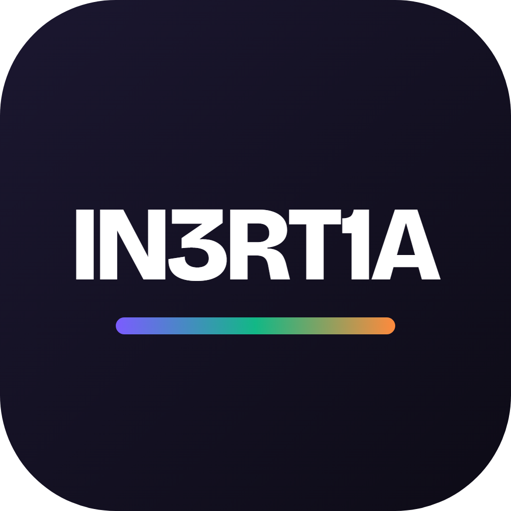
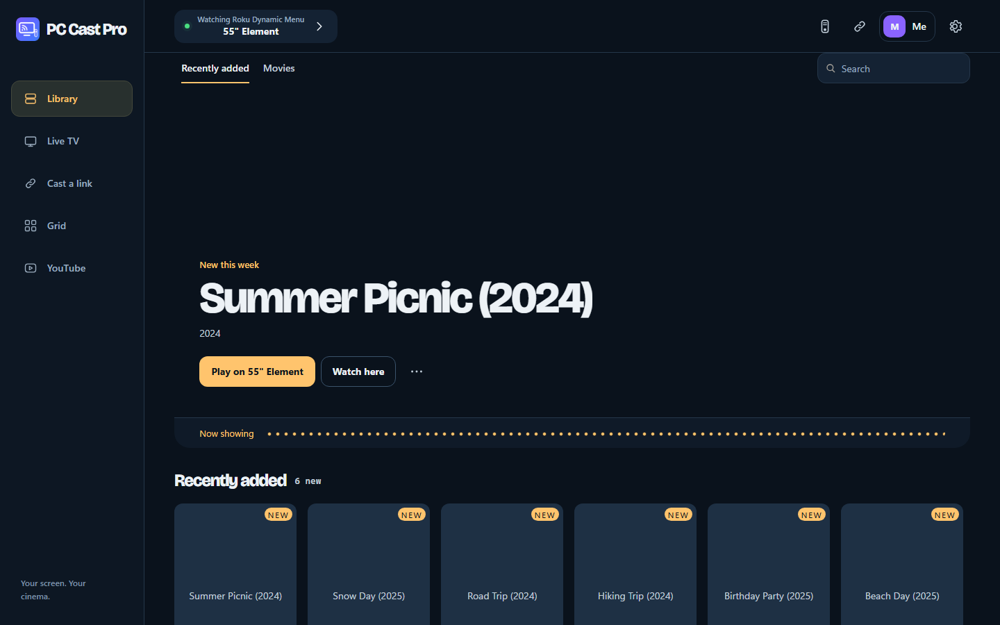
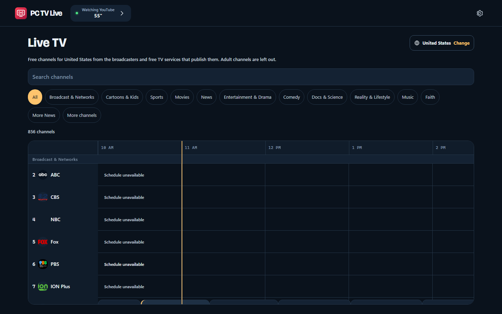
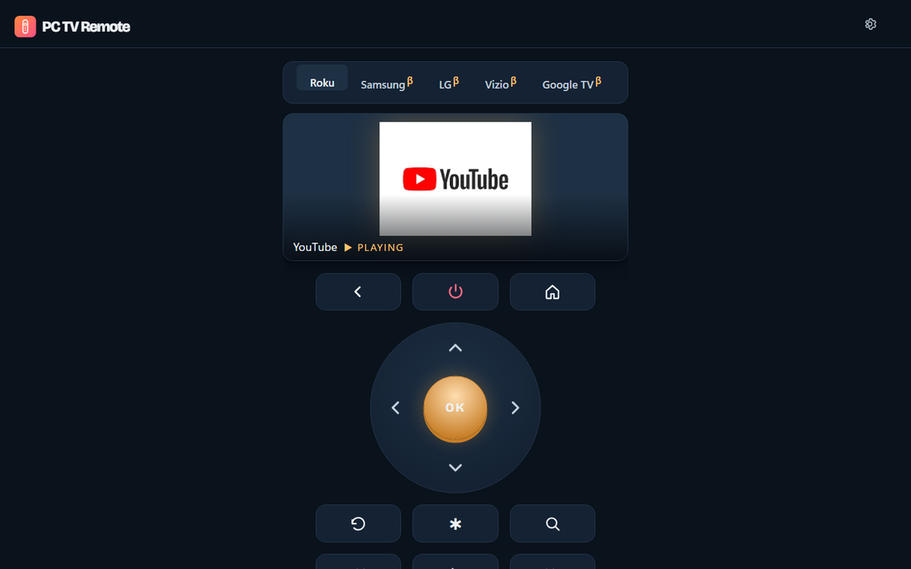
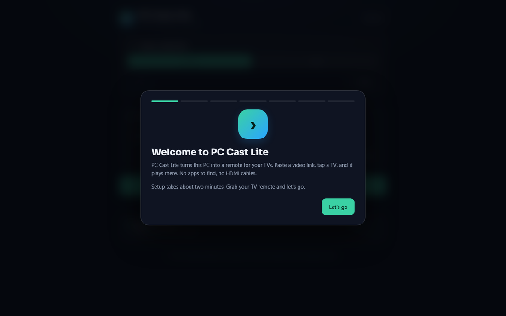

# IN3RT1A apps for desktop and mobile

Free apps that get your PC and your TVs working together.

**Website: [clark719664.github.io/pc-tv-apps](https://clark719664.github.io/pc-tv-apps/)**

## Download

| App | What it does | Windows | Linux |
|---|---|---|---|
| **PC Cast Pro** | The whole package: TV remote, casting from any link, multicast to many TVs, your PC's video library, multi-screen grids and free live TV | [Setup.exe](https://github.com/clark719664/pc-tv-apps/releases/latest/download/PC-Cast-Pro-Setup.exe) | [tar.gz](https://github.com/clark719664/pc-tv-apps/releases/latest/download/PC-Cast-Pro-Linux-x86_64.tar.gz) |
| **PC Cast Lite** | Just the casting. Paste a link and it plays on one TV or several | [Setup.exe](https://github.com/clark719664/pc-tv-apps/releases/latest/download/PC-Cast-Lite-Setup.exe) | [tar.gz](https://github.com/clark719664/pc-tv-apps/releases/latest/download/PC-Cast-Lite-Linux-x86_64.tar.gz) |
| **PC TV Live** | Just free live TV: pick your country, get its channels and a guide | [Setup.exe](https://github.com/clark719664/pc-tv-apps/releases/latest/download/PC-TV-Live-Setup.exe) | [tar.gz](https://github.com/clark719664/pc-tv-apps/releases/latest/download/PC-TV-Live-Linux-x86_64.tar.gz) |
| **PC TV Remote** | Just the remote, in a small download | [Setup.exe](https://github.com/clark719664/pc-tv-apps/releases/latest/download/PC-TV-Remote-Setup.exe) | [tar.gz](https://github.com/clark719664/pc-tv-apps/releases/latest/download/PC-TV-Remote-Linux-x86_64.tar.gz) |

**Windows:** run the Setup file and click **Install**. Everything each app needs on the PC is included, and no administrator rights are needed. Setup offers to add a firewall rule so your TVs can reach the app; Windows asks for permission once.

**Linux (x86_64, Ubuntu 22.04 / Debian 12 or newer):** extract the tar.gz and run `./install.sh`. Add `--service` to run it in the background from boot, for a small always-on box.

Portable ZIPs, SHA-256 checksums and third-party source code are on [the latest release](https://github.com/clark719664/pc-tv-apps/releases/latest).

## Standalone mobile beta

These mobile versions run without a PC. They are separate, smaller versions of the desktop apps.

| App | Android | iPhone web |
|---|---|---|
| PC TV Live | [APK](https://github.com/clark719664/pc-tv-apps/releases/download/mobile-v2026.11.02.1/PC-TV-Live-Android.apk) | [Open web app](https://clark719664.github.io/pc-tv-apps/live/) |
| PC TV Remote | [APK](https://github.com/clark719664/pc-tv-apps/releases/download/mobile-v2026.11.02.1/PC-TV-Remote-Android.apk) | Not offered: browser networking cannot supply the existing TV protocols |
| PC Cast Pro / Lite | Not offered: desktop casting engine needs a separate port | Not offered |

Live mobile has a curated selection of direct HTTPS channels, search and favorites. It does not include the desktop guide, full country catalogue, PC library, web-page extraction, conversion or multi-TV casting. Safari offers AirPlay where supported. Channels may be offline or region restricted; an internet connection is required.

Remote bundles its own Python runtime and talks directly to TVs on the same Wi-Fi. Roku, Samsung, LG, Vizio and Google/Android TV adapters are included as beta compatibility paths. Real phone/TV compatibility is not established by a successful build. The app opens no server and stores pairing data in its private storage with Android backups disabled.

Android requires version 7 or later; Remote supports arm64-v8a and x86_64. iPhone: Safari → Share → Add to Home Screen. Android TV and Fire TV are not validated installation targets for these phone/tablet apps.

See [mobile release notes](https://github.com/clark719664/pc-tv-apps/releases/tag/mobile-v2026.11.02.1) for exact verification, checksums and source. Build instructions are in [android/README.md](android/README.md).

## Desktop screenshots

**PC Cast Pro** (your video library, with profiles)

**PC TV Live** (the guide for the United States)

**PC TV Remote**

**PC Cast Lite** (first-run welcome)

## What's new in 2026.11.06.1

- YouTube casts in PC Cast Pro and PC Cast Lite now play in English. Dubbed videos could start in a random language; a video with no English track plays in its original language.
- On a phone or in a short window, PC Cast Pro and PC TV Remote now scroll down to all of your TV's channels, and a swipe that starts on a button no longer presses it.

## What's new in 2026.11.02.1

- Cleaner controls, simpler navigation and a shared neutral-and-blue design across the desktop apps, Roku channel, mobile apps and download page.
- Automatic queue panels are removed. Roku shows *Playing next* when the next queued video starts; manual queue controls remain available.
- Updated Android Live and Remote beta downloads retain the existing signing key so they can update earlier versions.

## What's new in 2026.11.01.1

- **Queue hand-off on the TV:** the Roku channel shows *Playing next* with the next queued title ten seconds before a queued video ends, or *Nothing in queue* and returns to browsing after ten seconds. The old "That's all" card is gone.

## What's new in 2026.10.30.2

- **Fixed:** opening a second PC Cast / PC TV app (they share ports 7373 and 7374) crashed it with a traceback dialog. It now says which app to close. The apps still run one at a time.

## What's new in 2026.10.30.1

Reliability fixes for casting, now in all four apps on Windows and Linux.

- **Casting a link is steadier**: every video segment is fetched completely before it goes to the TV, so a stalled or cut-short download no longer leaves a hole or broken frames; sources that answer "too many requests" are left alone for a while.
- **Long videos keep playing**: a video that was still casting can no longer be dropped from the app's short-term cache partway through.
- **Roku starts converted streams from any point**, and converted audio is sent as plain stereo AAC that every Roku decodes. Live streams are flagged as live.
- **Quality picker shows the truth**: each option lists its own resolution, frame rate, codec and bit rate, and the label after you pick matches what plays.
- **Episodes and queues**: Next/Previous, continuous play, 10-second skips and a per-season Skip intro marker for cast episodes; a play-in-order queue for links and YouTube videos; signed-in YouTube home shows the account's own recommendations.

[Downloads, portable ZIPs, application source and checksums](https://github.com/clark719664/pc-tv-apps/releases/latest). Earlier releases: best-quality cast-a-link, more pages, PC TV Live guide, multicast, embedded players and Linux builds. See [all releases](https://github.com/clark719664/pc-tv-apps/releases).

## Setup

Keep the PC on and awake, on the same network as the TV. TVs are found automatically, and the apps walk you through any TV pairing and the one-time Roku PC Cast channel setup.

Tested by the developer on TVs on their own network. Other TV models can vary; additional TV brands and casting protocols remain beta.

The apps aren't code-signed yet, so Windows SmartScreen may warn you. Click **More info**, then **Run anyway**.

GitHub's automatically generated "Source code" archives are not the apps.

## Keep it free

All four apps are free, with no ads, no accounts and no trial. They stay that way because people who use them chip in when they can.

**[Donate on Payhip](https://payhip.com/b/Wn9fE)**: pay what you want, from $1. Payhip handles the checkout, and you get a thank-you PDF.

At checkout there's an optional box for a short message. Once it's approved, your first name and message scroll across the top of every app's home screen, for everyone who uses them. Messages are checked by hand before they appear, and you can leave the box empty.

Other ways to help, free:

- Share [payhip.com/IN3RT1A](https://payhip.com/IN3RT1A) or this page with someone who has a smart TV.
- Star this repository so more people find it.
- [Open an issue](https://github.com/clark719664/pc-tv-apps/issues) if something doesn't work on your TV; it's how other models get supported.

Every app is also listed on the [IN3RT1A store](https://payhip.com/IN3RT1A) for free, if you'd rather download from there.
