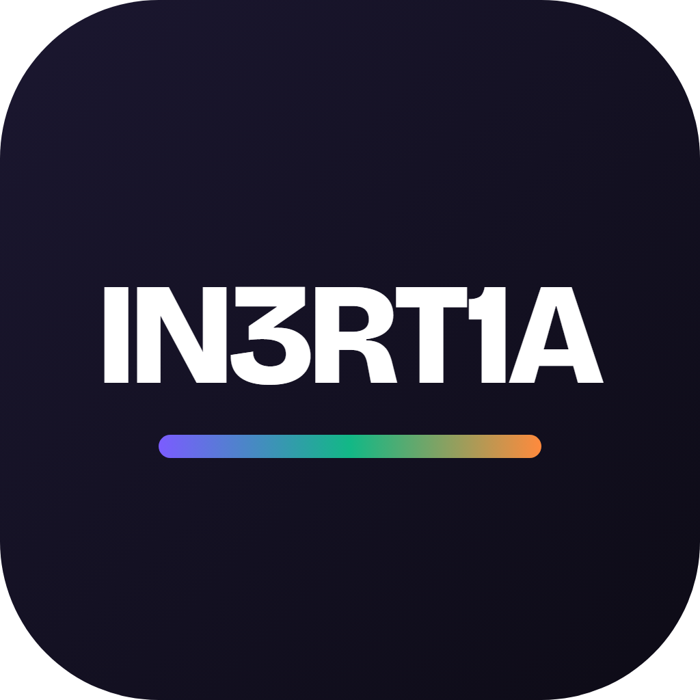
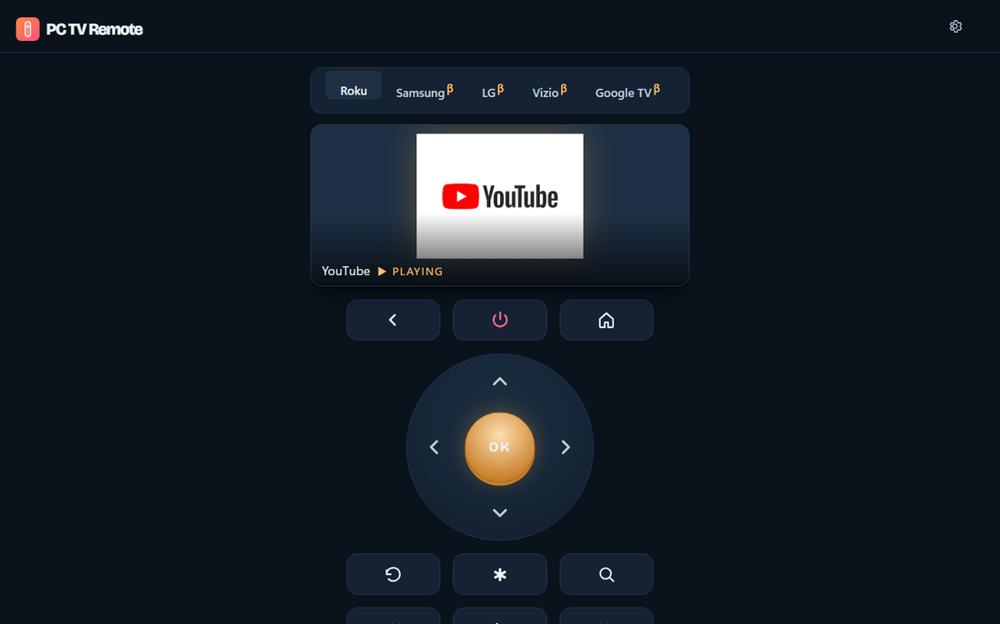
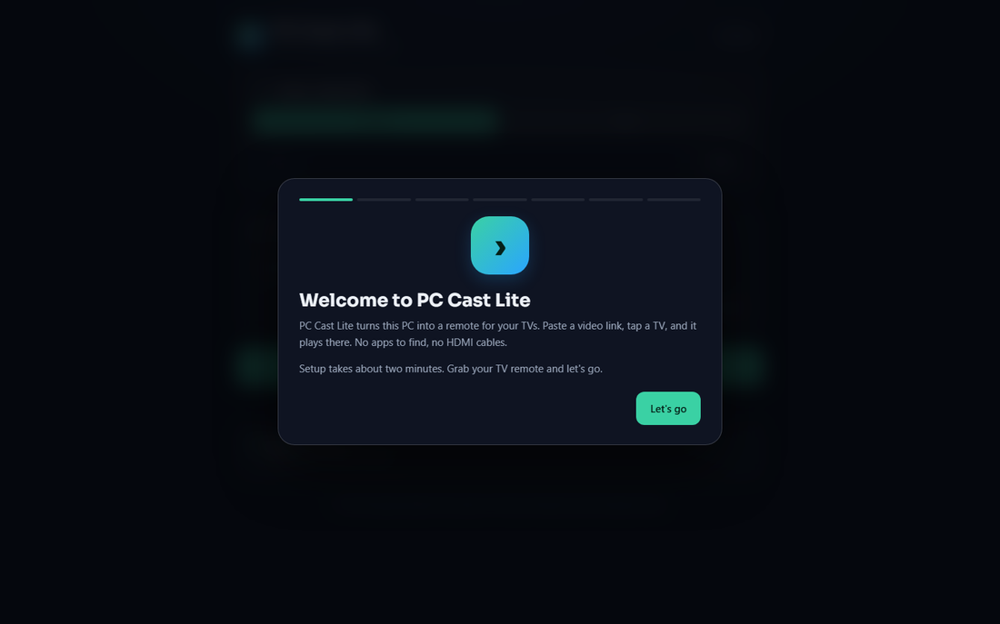

# IN3RT1A apps for Windows

Free Windows apps that get your PC and TV working together.

## Download (one-click installers)

- [PC Cast Pro](https://github.com/clark719664/pc-tv-apps/releases/latest/download/PC-Cast-Pro-Setup.exe): the whole package. Your TVs' remote, casting from any link, your PC's video library, multi-screen grids and live TV.
- [PC Cast Lite](https://github.com/clark719664/pc-tv-apps/releases/latest/download/PC-Cast-Lite-Setup.exe): just the casting. Paste a link and it plays on your TV.
- [PC TV Remote](https://github.com/clark719664/pc-tv-apps/releases/latest/download/PC-TV-Remote-Setup.exe): just the remote, in a small download.

Run the Setup file and click **Install**. Everything each app needs on the PC is included, and no administrator rights are needed.

Portable ZIPs, SHA-256 checksums and third-party source code are on [the latest release](https://github.com/clark719664/pc-tv-apps/releases/latest).

## Screenshots

**PC TV Remote**

**PC Cast Lite** (first-run welcome)

## Setup

Keep the PC on and awake, on the same network as the TV. TVs are found automatically, and the apps walk you through any TV pairing and the one-time Roku PC Cast channel setup.

Tested by the developer on TVs on their own network. Other TV models can vary; additional TV brands and casting protocols remain beta.

The apps aren't code-signed yet, so Windows SmartScreen may warn you. Click **More info**, then **Run anyway**.

GitHub's automatically generated "Source code" archives are not the Windows apps.

## Donate

The apps are free. A [donation](https://payhip.com/b/Wn9fE) of any amount from $1 helps keep them that way.
